```mermaid
sequenceDiagram
    autonumber
    actor DB as Delivery Boy
    participant App as Android App
    participant Store as Mobile Local DB
    participant Frappe as Frappe API Wrapper
    participant Tele as Telemetry Service

    %% ---------- 1. Register device ----------
    Note over DB,Tele: 1. First use - Register Device (BR01, BR02)
    DB->>App: Enter mobile number + PIN, grant permissions
    App->>Frappe: POST /api/method/delivery_management.mobile_tracking.register_device<br/>{mobile_number, pin, device_id, device_details}
    Frappe-->>App: message {driver, vehicle, route, device, assignment,<br/>telemetry{endpoint, api_key, capture_interval_seconds,<br/>upload_interval_seconds, max_records_per_request}}
    App->>Store: Save PIN + telemetry api_key in secure storage

    %% ---------- 2. Start trip ----------
    Note over DB,Tele: 2. Start Trip (BR03, BR06)
    DB->>App: Tap Start, capture start odometer photo, confirm
    App->>Store: Generate request_id, save started_at (UTC) + photo
    App->>Store: Begin recording GPS locally (no trip ID yet)
    loop Until Frappe returns a trip_id (same request_id on every retry)
        App->>Frappe: POST /api/method/delivery_management.mobile_tracking.start_tracking<br/>{mobile_number, pin, device_id, request_id, started_at,<br/>odometer_photo (data URI), device_details}
        alt Success or same request_id replayed
            Frappe-->>App: message {trip_id, status "In Transit", started_at,<br/>telemetry config, warnings}
        else Network failure or 5xx
            Frappe--xApp: Timeout / error
            Note right of App: Keep data, retry with<br/>exponential backoff + jitter
        end
    end
    App->>DB: Show tracking with trip ID

    %% ---------- 3. Tracking and upload ----------
    Note over DB,Tele: 3. Background tracking and telemetry upload (BR04 - BR08)
    par GPS capture (foreground service, screen off OK)
        loop Every capture_interval_seconds (default 10s)
            App->>Store: Save reading {lat, lng, speed, heading,<br/>accuracy, altitude, deviceTime UTC}
        end
    and Upload buffered readings
        loop Every upload_interval_seconds (default 30s)
            App->>Store: Read up to max_records_per_request readings
            App->>Tele: POST telemetry.endpoint (/v1/ingest/mobile_app)<br/>Headers: X-API-Key, Idempotency-Key (batch UUID), X-Correlation-ID<br/>Body: data[ {tripId, deviceId, lat, lng, speedKph, ...deviceTime} ]
            alt 202 Accepted
                Tele-->>App: {accepted: true, duplicate: false, idempotency_key, raw_object_key}
                App->>Store: Mark batch acknowledged
            else 202 duplicate (earlier response was lost)
                Tele-->>App: {accepted: true, duplicate: true, idempotency_key}
                App->>Store: Mark batch acknowledged
            else 413 Payload too large
                Tele-->>App: 413
                App->>App: Split into smaller batches
            else 429 Rate limited
                Tele-->>App: 429 (Retry-After)
                App->>App: Wait for Retry-After, then retry same Idempotency-Key
            else 401/403 Auth problem
                Tele-->>App: 401 or 403
                App->>DB: Action required (stop rapid retries)
            else 409 Key reused with different content
                Tele-->>App: 409
                App->>App: Mark batch for technical support
            else Network failure or 5xx
                Tele--xApp: Timeout / error
                App->>App: Keep batch, retry with backoff + jitter,<br/>reuse the SAME Idempotency-Key
            end
        end
    end

    %% ---------- 4. Stop trip ----------
    Note over DB,Tele: 4. Stop Trip (BR09)
    DB->>App: Tap Stop, capture end odometer photo
    App->>Store: Save stopped_at (UTC) + photo, stop GPS capture
    App->>Tele: Flush all remaining queued readings (same headers as above)
    Tele-->>App: 202 Accepted for every remaining batch
    loop Until Frappe confirms (repeat Stop on a completed trip = success)
        App->>Frappe: POST /api/method/delivery_management.mobile_tracking.stop_tracking<br/>{mobile_number, pin, device_id, trip_id, stopped_at,<br/>odometer_photo (data URI)}
        alt Success
            Frappe-->>App: message {trip_id, status "Completed", started_at, stopped_at, warnings}
        else Network failure or 5xx
            Frappe--xApp: Timeout / error
            Note right of App: Show "stored locally, syncing",<br/>retry with backoff
        end
    end
    App->>DB: Show Completed only after Stop API succeeds
```

4 User Journey
1.	On first use, the delivery boy enters mobile number and predefined PIN and grants the required location, notification, and camera permissions.
2.	The app registers the phone using a stable device identifier and receives the assigned driver, vehicle, route, and telemetry configuration.
3.	The delivery boy taps Start, captures the odometer photograph, and confirms the action.
4.	The app immediately begins recording GPS locally. It submits the Start request until Frappe returns a trip ID. The app must not claim that a trip exists before this response is received.
5.	After a trip ID is received, all queued and new readings are uploaded to the telemetry service with that trip ID.
6.	The delivery boy taps Stop and captures the ending odometer photograph. The app uploads remaining readings and submits the Stop request.
7.	The app shows completion only after the Stop API succeeds. If any step is pending, it clearly shows that data is stored locally and synchronization will continue.
5 Functional Requirements
ID	Area	Requirement
BR 01	Authentication	Accept a 10 digit Indian mobile number, including +91 formatting, and a predefined 4 to 8 digit PIN. Do not expose whether the mobile number or PIN was incorrect.
BR 02	Device identity	Use one stable installation or device identifier. Do not use IMEI or another restricted hardware identifier. Send platform, manufacturer, model, OS version, and app version.
BR 03	Start	Generate one stable request ID for each user initiated Start. Reuse it for every retry of that same Start. Capture the Start time in UTC and require a start odometer photo.
BR 04	Tracking	Capture a high accuracy reading every 10 seconds while active, unless the server response supplies another interval. Each reading keeps its original UTC device timestamp.
BR 05	Background operation	Continue tracking with the screen off, while minimized, and after removal from recent apps. Use an Android foreground location notification as required by Android.
BR 06	Offline operation	Store Start, Stop, odometer evidence, and every GPS reading locally until acknowledged by the corresponding service. No reading may be discarded merely because the network is unavailable.
BR 07	Upload	Upload buffered readings every 30 seconds by default, or use the interval returned by the server. Upload up to the server supplied maximum records per request.
BR 08	Retry	Retry automatically with exponential backoff and jitter. A retry of the same telemetry batch must reuse the same Idempotency Key. Resume retry after app restart, process termination, network recovery, and device reboot when Android permits.
BR 09	Stop	Require an end odometer photo. Do not mark the trip completed in the UI until Frappe confirms the Stop request. A repeated Stop for an already completed trip must be treated as success.
BR 10	User status	Show one of: ready, starting offline, tracking with trip ID, tracking offline with pending count, stopping and synchronizing, completed, or action required. Display useful backend errors without exposing secrets.
BR 11	Data retention	Retain unsent records until acknowledged. Retain enough local state to recover an unfinished session. Uploaded data may be cleaned up according to a vendor-defined safe retention policy.
BR 12	Privacy	Store the PIN and telemetry API key using Android secure storage. Odometer photographs are trip evidence and must not be saved to the public gallery.
6 API Contract
All timestamps use ISO 8601 UTC, for example 2026-10-12T08:30:00Z. All examples omit real credentials. Frappe method responses place the business response inside the top-level message property.
6.1 Common Frappe API Rules
•	Method: POST
•	Content Type: application/json
•	Base URL: supplied separately for each environment and embedded in the build or managed configuration
•	Optional header X-Frappe-Site-Name may be required when a host serves multiple Frappe sites
6.2 Register Device
Endpoint: /api/method/delivery_management.mobile_tracking.register_device
Field	Required	Type	Business meaning
mobile_number	Yes	String	Delivery boy mobile number
pin	Yes	String	Predefined PIN
device_id	Yes	String	Stable app or device identifier
device_details	Recommended	Object	Platform, manufacturer, device_model, os_version, app_version
{
  "mobile_number": "9876543210",
  "pin": "1234",
  "device_id": "stable-installation-id",
  "device_details": {
    "platform": "android",
    "manufacturer": "Samsung",
    "device_model": "SM-A135F",
    "os_version": "14",
    "app_version": "1.0.0"
  }
}

Successful message object:
{
  "driver": "HR-DRI-2026-00002",
  "vehicle": "AK11AK00001",
  "route": "DR-000001",
  "device": "TD-00001",
  "device_id": "stable-installation-id",
  "assignment": "TDA-00001",
  "telemetry": {
    "source": "mobile_app",
    "endpoint": "https://telemetry.example/v1/ingest/mobile_app",
    "api_key": "provided-by-server",
    "capture_interval_seconds": 10,
    "upload_interval_seconds": 30,
    "max_records_per_request": 5000
  }
}

6.3 Start Tracking and Create Trip
Endpoint: /api/method/delivery_management.mobile_tracking.start_tracking
Field	Required	Type	Business meaning
mobile_number	Yes	String	Delivery boy mobile number
pin	Yes	String	Predefined PIN
device_id	Yes	String	Same stable identifier used for registration
request_id	Yes	String	Stable 8 to 80 character idempotency key for this Start
started_at	Yes for offline	Datetime	Actual UTC time when the delivery boy tapped Start
odometer_photo	Yes	Data URI	JPEG or PNG, base64 encoded, maximum decoded size 5 MB
device_details	Recommended	Object	Current device and app details
{
  "mobile_number": "9876543210",
  "pin": "1234",
  "device_id": "stable-installation-id",
  "request_id": "start_7f15b8d8_20261012",
  "started_at": "2026-10-12T08:30:00Z",
  "odometer_photo": "data:image/jpeg;base64,<base64-data>",
  "device_details": {"platform": "android", "app_version": "1.0.0"}
}

The response contains the registration fields plus trip_id, status, and started_at. The same request_id must return the same trip. If an earlier response was interrupted, the server may return the active trip with a warning; the app must continue that trip instead of creating another one.
{
  "trip_id": "TRIP-2026-00001",
  "status": "In Transit",
  "started_at": "2026-10-12T08:30:00Z",
  "warnings": []
}

6.4 Upload Telemetry
Endpoint: returned as telemetry.endpoint, normally /v1/ingest/mobile_app
Required headers:
Field	Required	Type	Business meaning
Content-Type	Yes	Header	application/json
X-API-Key	Yes	Header	Value returned by Frappe; never shown to the delivery boy
Idempotency-Key	Yes	Header	Stable unique ID for the batch; reuse for every retry of that batch
X-Correlation-ID	Recommended	Header	Client generated trace ID for support and diagnostics

Each request contains a data array. Up to max_records_per_request readings may be included.
{
  "data": [
    {
      "tripId": "TRIP-2026-00001",
      "deviceId": "stable-installation-id",
      "latitude": 12.9716,
      "longitude": 77.5946,
      "speedKph": 18.5,
      "headingDegrees": 125.0,
      "accuracyMeters": 7.2,
      "altitudeMeters": 910.0,
      "batteryPercent": 82.0,
      "isMock": false,
      "deviceTime": "2026-10-12T08:31:10Z"
    }
  ]
}

Successful acceptance uses HTTP 202. Processing is asynchronous.
{
  "accepted": true,
  "duplicate": false,
  "record_count": null,
  "body_bytes": 412,
  "idempotency_key": "batch-uuid",
  "raw_object_key": "server-generated-object-key",
  "correlation_id": "client-or-server-correlation-id"
}

6.5 Stop Tracking and Complete Trip
Endpoint: /api/method/delivery_management.mobile_tracking.stop_tracking
Field	Required	Type	Business meaning
mobile_number	Yes	String	Delivery boy mobile number
pin	Yes	String	Predefined PIN
device_id	Yes	String	Device that owns the active trip
trip_id	Yes	String	Trip returned by Start
stopped_at	Yes for offline	Datetime	Actual UTC time when the delivery boy tapped Stop
odometer_photo	Yes	Data URI	JPEG or PNG, base64 encoded, maximum decoded size 5 MB
{
  "mobile_number": "9876543210",
  "pin": "1234",
  "device_id": "stable-installation-id",
  "trip_id": "TRIP-2026-00001",
  "stopped_at": "2026-10-12T11:45:00Z",
  "odometer_photo": "data:image/jpeg;base64,<base64-data>"
}

The successful message object returns trip_id, status Completed, started_at, stopped_at, and the same driver, vehicle, device, assignment, and telemetry context. Warnings indicate that a downstream telemetry operation is pending; they are not payment or settlement decisions.
7 Error and Retry Behaviour
Condition	Meaning	App behaviour
400 or 417	Validation error	Show the server message. Keep locally captured data. Ask the user to correct only when the error requires user action.
401 or 403	Authentication or authorization	Stop rapid retries. Ask the user to verify mobile number and PIN or contact support.
404	Unknown API or integration	Keep data and show configuration error. Do not ask the delivery boy to enter an endpoint.
409	Idempotency key reused for different content	Do not silently generate a new key for the same batch. Mark the batch for technical support.
413	Payload too large	Split telemetry into smaller batches. Compress or resize an odometer photo before retrying within the 5 MB decoded limit.
429	Rate limited	Honor Retry After when present, otherwise back off.
500 to 599 or network failure	Temporary failure	Keep data and retry automatically with exponential backoff and jitter.
8 Acceptance Criteria
1.	A configured delivery boy can log in using mobile number and predefined PIN without entering any endpoint or API key.
2.	Start creates or safely recovers exactly one trip, and the UI displays the returned trip ID.
3.	Start and end odometer photographs are received as private evidence and associated with the same trip.
4.	GPS points are recorded approximately every 5 seconds during active tracking with the original timestamps.
5.	Tracking continues with the screen off and after the app is removed from recent apps.
6.	When connectivity is disabled, points remain queued. After connectivity returns, every point is uploaded once logically, even if HTTP requests are retried.
7.	An app restart and a device reboot do not lose an active or pending session.
8.	Stop completes the correct trip, and no further points are captured after the stop time.
9.	Backend failures never produce a false Tracking or Completed confirmation.

9 APIs
Start Trip with odometer photo
curl --fail-with-body \
  --request POST \
  "https://akshayakalpa-pm-test.nvi.frappe.cloud/api/method/delivery_management.mobile_tracking.start_tracking" \
  --header "Content-Type: application/json" \
  --data-binary "@start-trip.json"

JSON

{
  "mobile_number": "9876543210",
  "pin": "1234",
  "device_id": "stable-installation-id",
  "request_id": "start_550e8400e29b41d4",
  "started_at": "2026-10-13T08:30:00Z",
  "odometer_photo": "data:image/jpeg;base64,/9j/4AAQSkZJRgABAQ...",
  "device_details": {
    "platform": "android",
    "manufacturer": "Samsung",
    "device_model": "SM-A135F",
    "os_version": "14",
    "app_version": "1.0.0"
  }
}

Expected Response

{
  "message": {
    "driver": "HR-DRI-2026-00002",
    "vehicle": "AK11AK00001",
    "route": "DR-000001",
    "device": "TD-00001",
    "device_id": "stable-installation-id",
    "assignment": "TDA-00001",
    "trip_id": "TRIP-2026-00001",
    "status": "In Transit",
    "started_at": "2026-10-13T08:30:00Z",
    "telemetry": {
      "source": "mobile_app",
      "endpoint": "https://telemetry-uat.akshayakalpa.org/v1/ingest/mobile_app",
      "api_key": "<telemetry-api-key>",
      "capture_interval_seconds": 10,
      "upload_interval_seconds": 30,
      "max_records_per_request": 5000
    }
  }
}

 Stop Trip with odometer photo
curl --fail-with-body \
  --request POST \
  "https://akshayakalpa-pm-test.nvi.frappe.cloud/api/method/delivery_management.mobile_tracking.stop_tracking" \
  --header "Content-Type: application/json" \
  --data-binary "@stop-trip.json"

JSON

{
  "mobile_number": "9876543210",
  "pin": "1234",
  "device_id": "stable-installation-id",
  "trip_id": "TRIP-2026-00001",
  "stopped_at": "2026-10-13T11:45:00Z",
  "odometer_photo": "data:image/jpeg;base64,/9j/4AAQSkZJRgABAQ..."
}

Expected Response

{
  "message": {
    "driver": "HR-DRI-2026-00002",
    "vehicle": "AK11AK00001",
    "route": "DR-000001",
    "device": "TD-00001",
    "device_id": "stable-installation-id",
    "assignment": "TDA-00001",
    "trip_id": "TRIP-2026-00001",
    "status": "Completed",
    "started_at": "2026-10-13T08:30:00Z",
    "stopped_at": "2026-10-13T11:45:00Z",
    "telemetry": {
      "source": "mobile_app",
      "endpoint": "https://telemetry-uat.akshayakalpa.org/v1/ingest/mobile_app",
      "api_key": "<telemetry-api-key>",
      "capture_interval_seconds": 10,
      "upload_interval_seconds": 30,
      "max_records_per_request": 5000
    }
  }
}

Note: Call this only after the telemetry service has accepted all remaining queued GPS readings.

 Upload GPS readings
curl --fail-with-body \
  --request POST \
  "https://telemetry-uat.akshayakalpa.org/v1/ingest/mobile_app" \
  --header "Content-Type: application/json" \
  --header "X-API-Key: <TELEMETRY_API_KEY>" \
  --header "Idempotency-Key: batch-550e8400-e29b-41d4-a716-446655440000" \
  --header "X-Correlation-ID: trace-550e8400-e29b-41d4-a716-446655440001" \
  --data-binary "@telemetry-batch.json"

JSON

{
  "data": [
    {
      "tripId": "TRIP-2026-00001",
      "deviceId": "stable-installation-id",
      "latitude": 12.9716,
      "longitude": 77.5946,
      "speedKph": 18.5,
      "headingDegrees": 125.0,
      "accuracyMeters": 7.2,
      "altitudeMeters": 910.0,
      "deviceTime": "2026-10-13T08:31:10Z"
    },
    {
      "tripId": "TRIP-2026-00001",
      "deviceId": "stable-installation-id",
      "latitude": 12.9721,
      "longitude": 77.5952,
      "speedKph": 19.2,
      "headingDegrees": 128.0,
      "accuracyMeters": 6.8,
      "altitudeMeters": 911.0,
      "deviceTime": "2026-10-13T08:31:20Z"
    }
  ]
}

Expected Response

http
HTTP/1.1 202 Accepted

JSON
{
  "accepted": true,
  "duplicate": false,
  "record_count": null,
  "body_bytes": 824,
  "idempotency_key": "batch-550e8400-e29b-41d4-a716-446655440000",
  "raw_object_key": "server-generated-object-key",
  "correlation_id": "trace-550e8400-e29b-41d4-a716-446655440001"
}

Note: The same Idempotency-Key must be reused whenever the same batch is retried.
